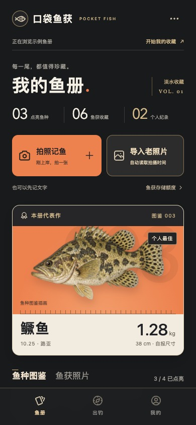
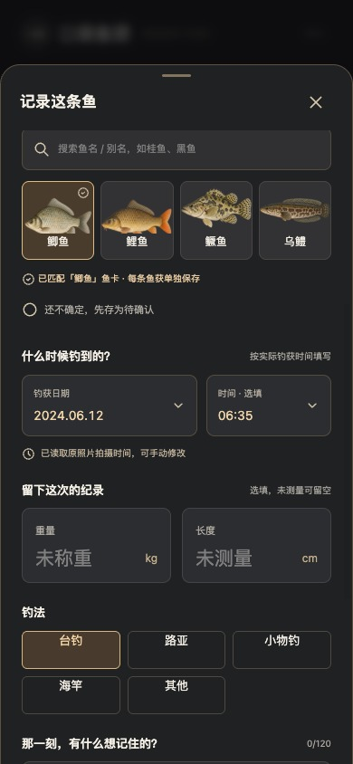
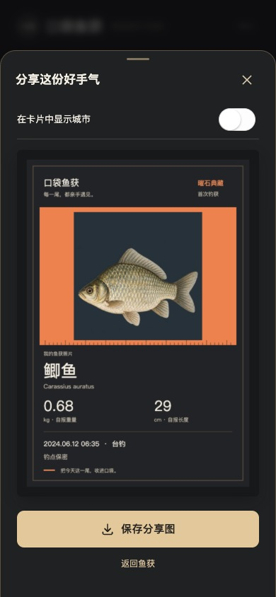

# 口袋鱼获

给钓鱼人的微信小程序。拍下每次钓获，关联鱼种图鉴，保留照片与钓获时间，并生成可保存的分享卡。

## 页面与功能截图

[查看全部 58 张截图与功能索引](screenshots/README.md)。截图集中在 [`screenshots/`](screenshots/) 文件夹，下载后打开 `截图目录.html` 可浏览缩略图。

<p>
  
  
  
</p>

截图来自 H5 预览及隔离样例账号，具体范围见截图索引。

## 运行

需要 Node.js 22.18+ 和 npm。照片、记录、会员等级与额度由服务端保存，用户以微信账号登录。

```sh
npm install
npm run dev -- --port 5173
```

打开 http://localhost:5173 。该命令同时启动网页和鱼册服务。网页仅作界面预览，默认展示示例鱼册；拍照记录等个人功能需在微信小程序中登录后使用。

```sh
npm run build          # 网页：dist/build/h5
npm run build:weixin   # 小程序：dist/build/mp-weixin
npm run server         # API + 已构建网页：http://localhost:8787
npm run type-check
npm test
```

微信开发者工具导入 `dist/build/mp-weixin`。先在 `src/manifest.json` 的 `mp-weixin.appid` 配置 AppID，服务端设置相同的 `WECHAT_APP_ID` 与 `WECHAT_APP_SECRET`，并设置 `VITE_API_BASE_URL` 为实际 HTTPS 服务地址；服务器域名需在微信后台配置。AppSecret 只保存在服务端。相机、相册、照片元数据保留情况和分享图保存仍需在微信开发者工具及手机上验证。

## 主要流程

- 首页直接选择「拍照记鱼」或「导入老照片」，每条鱼获有独立照片、鱼种、日期、时间和备注。
- 读取原照片的 EXIF 拍摄时间，再压缩上传；无拍摄时间的旧照片要求手动选择日期，不使用文件修改时间或上传时间冒充。时间允许手动修改。
- 搜索鱼名、别名或学名选择鱼卡，重复钓获归入同一鱼种，仍保留独立记录。不能确认的鱼可先保存待确认。
- 「鱼获照片」展示每次上传的照片；图鉴与详情展示对应鱼种和历次钓获。列表分批加载。
- 分享卡优先使用该条鱼获的实际上传照片，包含钓获日期、时间与自报尺寸。城市默认隐藏。
- 微信登录后取得经过服务端验证的账号；记录、照片、代表作、会员等级与额度都归属该账号。重新登录同一微信账号可读取同一份鱼册，不同账号互相隔离。
- 未提交内容只在当前编辑会话中保留，保存后才进入账号鱼册。保存失败可在当前页面重试，相同记录编号不会重复占用额度。

## 存储额度

| 等级 | 鱼获上限 |
| --- | ---: |
| 普通会员 | 30 条 |
| 进阶会员 | 300 条 |
| 典藏会员 | 3,000 条 |

每条鱼获占一个名额，同种鱼多次钓获分别计数；编辑不增加名额，删除释放名额。达到上限后仍能查看、编辑和导出旧记录。等级降低不删除已有记录。具体规则在 `src/domain.ts`，管理方式见[服务配置](docs/service.md)。

## 当前范围

目前图鉴包含鲫鱼、鲤鱼、鳜鱼和乌鳢，其他鱼种可先记为待确认。图鉴插画为生成式视觉素材，不承担物种鉴定功能。

自动识鱼支持服务端模型接口，但默认未配置，因此当前可以手动搜索归卡，不能自动识别。接入后显示候选，仍由用户确认。识鱼准确率未经过真实鱼获样本验证。

微信登录链路已实现，需要有效 AppID、AppSecret 与 HTTPS 服务配置后进行微信开发者工具及真机联调；未配置时不会自动创建其他身份。浏览器不模拟微信登录。支付与自助会员开通尚未接入，会员额度不代表已开通付费业务。分享交付为图片，不提供公开个人相册链接。

设计依据见[人群与品牌研究](docs/audience-and-brand-research.md)。图标采用 Tabler Icons（MIT），许可文件在 `src/static/icons/LICENSE`。
